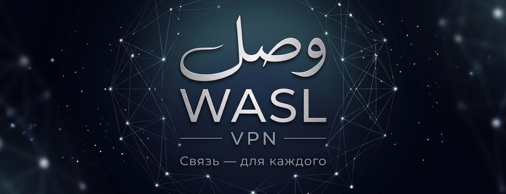
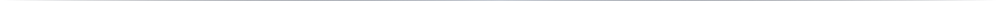
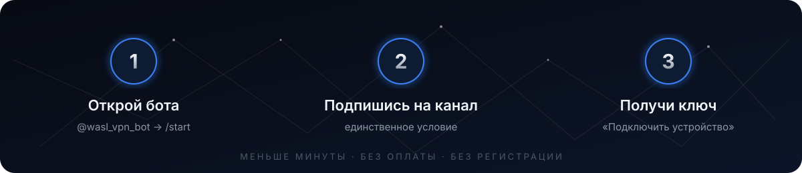
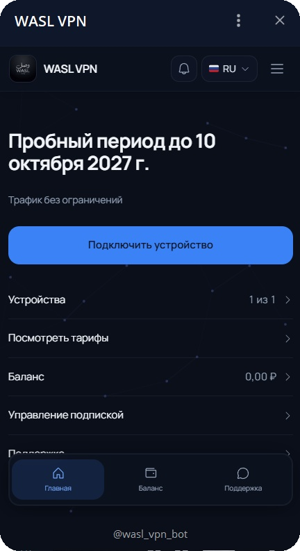
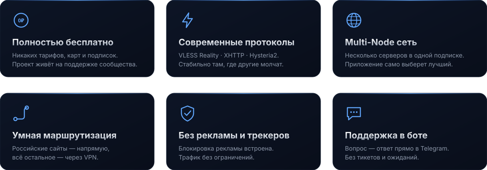
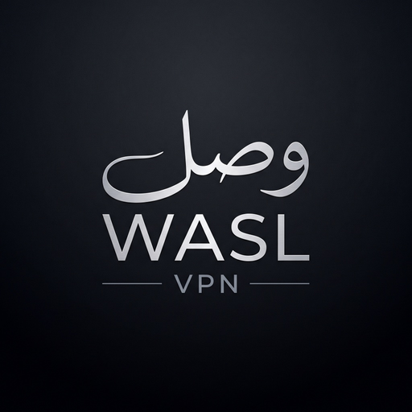

<a name="top"></a>
<p align="center">
  <a href="https://t.me/wasl_vpn_bot">
    
  </a>
</p>

<h1 align="center">WASL VPN</h1>

<p align="center">
  <b>Связь — для каждого.</b><br>
  Бесплатный Multi-Node VPN нового поколения. Без тарифов, без рекламы, без регистрации.<br>
  Ключ выдаётся за минуту прямо в Telegram.
</p>

<p align="center">
  <a href="https://t.me/wasl_vpn_bot">
    
  </a>
  &nbsp;
  <a href="https://app.lava.top/2107724612?tabId=donate">
    
  </a>
</p>

<p align="center">
  
  
  
  
  
</p>

<p align="center">
  <a href="#-как-подключиться">Как подключиться</a> ·
  <a href="#-почему-wasl">Почему WASL</a> ·
  <a href="#-приложения">Приложения</a> ·
  <a href="#-под-капотом">Под капотом</a> ·
  <a href="#-faq">FAQ</a> ·
  <a href="#%EF%B8%8F-поддержать-проект">Поддержать</a>
</p>



## 🚀 Как подключиться

<p align="center">
  <a href="https://t.me/wasl_vpn_bot"></a>
</p>

<table align="center">
<tr>
<td width="50%" valign="top">

### Три шага и ты онлайн

**1. Открой бота** — [@wasl_vpn_bot](https://t.me/wasl_vpn_bot) и нажми **Старт**. Откроется мини-приложение WASL.

**2. Подпишись на канал** — это единственное условие бесплатного доступа. Никаких карт, телефонов и анкет.

**3. Нажми «Подключить устройство»** — бот выдаст ссылку-подписку и покажет инструкцию под твою платформу.

> ⏱ Весь процесс занимает меньше минуты.
> Одна подписка — один тариф **WASL**, трафик без ограничений.

<p>
  <a href="https://t.me/wasl_vpn_bot">
    
  </a>
</p>

</td>
<td width="50%" align="center">


<br>
<sub>Мини-приложение WASL прямо внутри Telegram</sub>

</td>
</tr>
</table>


## ✨ Почему WASL

<p align="center">
  
</p>

<table align="center">
<tr>
<td align="center" width="33%">
<h3>🆓 Честно бесплатно</h3>
Никаких «пробных периодов», скрытых тарифов и платных серверов. Проект живёт на поддержке сообщества, а не на твоей карте.
</td>
<td align="center" width="33%">
<h3>⚡ Не уступает платным</h3>
Та же инфраструктура, что у коммерческих сервисов: панель <b>Remnawave</b>, современные протоколы, несколько нод в одной подписке.
</td>
<td align="center" width="33%">
<h3>🧭 Умный маршрут</h3>
Российские сайты, банки и Госуслуги открываются напрямую — быстро и без капч. Остальное — через VPN.
</td>
</tr>
</table>


## 📱 Приложения

Подписка WASL работает в любом современном клиенте. Мы рекомендуем **Happ** — он сам подтянет все серверы и правила маршрутизации по одной ссылке.

<table align="center">
  <tr>
    <th align="left">Платформа</th>
    <th align="left">Рекомендуем</th>
    <th align="left">Альтернатива</th>
  </tr>
  <tr>
    <td>🍎 <b>iPhone / iPad</b></td>
    <td><a href="https://apps.apple.com/app/happ-proxy-utility/id6504287215">Happ</a></td>
    <td>Shadowrocket <sub>(включить HWID в настройках)</sub></td>
  </tr>
  <tr>
    <td>🤖 <b>Android</b></td>
    <td><a href="https://play.google.com/store/apps/details?id=com.happproxy">Happ</a></td>
    <td>v2RayTun</td>
  </tr>
  <tr>
    <td>🪟 <b>Windows</b></td>
    <td><a href="https://www.happ.su/">Happ</a></td>
    <td>Hiddify</td>
  </tr>
  <tr>
    <td>💻 <b>macOS</b></td>
    <td><a href="https://www.happ.su/">Happ</a></td>
    <td>Hiddify</td>
  </tr>
</table>

> 📌 Одна подписка привязывается к **одному устройству**. Нужно переставить на другое — напиши в поддержку прямо в боте.


## 🔧 Под капотом

<table align="center">
<tr>
<td width="50%" valign="top">

```text
┌──────────────────────────────────────┐
│  WASL VPN · Multi-Node by RIXXX      │
├──────────────────────────────────────┤
│  Панель        Remnawave             │
│  Ядро          Xray-core             │
│  Протоколы     VLESS Reality         │
│                XHTTP                 │
│                Hysteria 2            │
│  Маршрутизация RU → direct           │
│                WORLD → VPN           │
│  Фильтрация    Ads + Trackers        │
│  Лимиты        трафик — нет          │
│                устройств — 1         │
│  Цена          0 ₽                   │
└──────────────────────────────────────┘
```

</td>
<td width="50%" valign="top">

**VLESS Reality** — маскирует трафик под обычный TLS к популярным сайтам. Не детектируется DPI.

**XHTTP** — транспорт поверх HTTP/2 и HTTP/3, стабилен на мобильных сетях и в условиях ограничений.

**Hysteria 2** — протокол на базе QUIC, выжимает максимум скорости даже на «плохом» канале.

**Remnawave** — современная панель управления узлами. Та же, что используют серьёзные коммерческие сервисы.

Приложение получает все серверы одной подпиской и автоматически переключается на лучший.

</td>
</tr>
</table>


## ❓ FAQ

<details>
<summary><b>Это правда бесплатно? В чём подвох?</b></summary>
<br>
Подвоха нет. Единственное условие — подписка на наш Telegram-канал. Проект существует на донаты и поддержку спонсоров, поэтому мы не продаём тарифы и не показываем рекламу.
</details>

<details>
<summary><b>Нужно ли вводить номер телефона, почту или карту?</b></summary>
<br>
Нет. Бот использует только твой Telegram-аккаунт. Никаких анкет и платёжных данных.
</details>

<details>
<summary><b>Какое приложение выбрать?</b></summary>
<br>
<b>Happ</b> — на любой платформе. Он поддерживает все наши протоколы и правила маршрутизации из коробки. Ссылки на скачивание — в разделе <a href="#-приложения">Приложения</a> и в самом боте.
</details>

<details>
<summary><b>Почему российские сайты открываются напрямую?</b></summary>
<br>
Так задумано: банки, Госуслуги, маркетплейсы и стриминги не любят иностранные IP. Умная маршрутизация пускает российский трафик мимо VPN — быстрее и без капч, а всё остальное защищено.
</details>

<details>
<summary><b>Можно ли использовать на нескольких устройствах?</b></summary>
<br>
Одна подписка — одно устройство. Если нужно перенести ключ, напиши в поддержку в боте — поможем.
</details>

<details>
<summary><b>Что-то не работает. Куда писать?</b></summary>
<br>
В боте есть кнопка <b>🛠 Техподдержка</b> — ответим прямо в Telegram. Это быстрее любых тикетов.
</details>


## ❤️ Поддержать проект

WASL бесплатен для всех и останется таким. Серверы, трафик и время — это реальные расходы, и проект живёт благодаря людям, которым он помог.

**Для получения ключа донат не нужен.** Но если WASL выручил тебя — ты можешь помочь ему выручать других.

<p align="center">
  <a href="https://app.lava.top/2107724612?tabId=donate">
    
  </a>
</p>

<p align="center">
  <sub>Рассказать о WASL друзьям — тоже поддержка. Связь — для каждого.</sub>
</p>


<p align="center">
  
</p>

<p align="center">
  <a href="https://t.me/wasl_vpn_bot"><b>Telegram-бот</b></a> ·
  <a href="https://app.lava.top/2107724612?tabId=donate"><b>Поддержать</b></a> ·
  <a href="#top"><b>Наверх ↑</b></a>
</p>

<p align="center">
  <sub>© WASL VPN · Multi-Node VPN by RIXXX · Связь — для каждого</sub>
</p>
